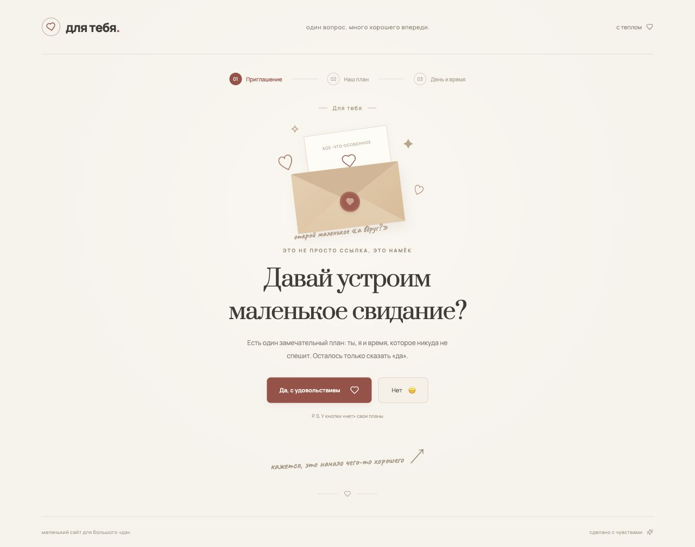

# InviteApp 💌

Сайт для личного приглашения на свидание, который можно запустить на своём компьютере или разместить на собственном сервере и домене.

Посетитель отвечает на приглашение, выбирает занятие, дату и время и получает финальную карточку встречи. Тексты и варианты занятий настраиваются в защищённой админке. Все настройки и ответы хранятся в SQLite.



## Возможности

- Приглашение с вашими заголовком, обращением и текстом.
- Кнопки «Да» и «Нет»: «Нет» убегает при наведении мыши и касании.
- Выбор занятия из списка, который вы задаёте в админке.
- Календарь и выбор времени встречи с проверкой, что дата и время ещё не прошли.
- Финальная карточка с вашим текстом, выбранными занятием, датой и временем.
- Скачивание приглашения в календарь (`.ics`, продолжительность события — 2 часа).
- Админка с просмотром последних 200 ответов.
- Адаптивный интерфейс для телефона и компьютера.
- Запуск через Docker Compose; автоматический HTTPS через Caddy для своего домена.

## Стек

| Компонент | Технологии |
|---|---|
| Frontend | React, Vite, CSS, Lucide |
| Backend | Python, FastAPI, Uvicorn |
| Хранение | SQLite |
| Развёртывание | Docker, Docker Compose, Caddy |

Frontend собирается в статические файлы и раздаётся тем же Python-приложением, что и API. Node.js нужен на этапе сборки; устанавливать Python и Node.js на сервер отдельно при использовании Docker не требуется.

## Быстрый локальный запуск

Потребуется Docker с поддержкой команды `docker compose`. На macOS и Windows можно использовать Docker Desktop, на Linux — Docker Engine с Compose plugin.

```sh
git clone https://github.com/M1ke0-0/InviteApp.git
cd InviteApp
cp .env.example .env
```

Откройте `.env` и задайте **свой пароль длиной не менее 12 символов**:

```dotenv
ADMIN_PASSWORD=replace-with-your-own-long-password
PORT=8080
APP_TIMEZONE=Europe/Moscow
COOKIE_SECURE=false
SITE_DOMAIN=example.ru
```

Значение пароля в примере — заглушка, замените его. Для локального запуска `SITE_DOMAIN` не используется.

```sh
docker compose up -d --build
```

Откройте:

- приглашение: [http://localhost:8080](http://localhost:8080);
- админку: [http://localhost:8080/admin](http://localhost:8080/admin).

При первом запуске автоматически создаются база и демонстрационные тексты. Пароль админки берётся из вашего `.env`; отдельного логина нет.

## Как пользоваться

1. Откройте `/admin` и введите пароль из `ADMIN_PASSWORD`.
2. Настройте обращение, заголовок и текст первой страницы.
3. Добавьте занятия: эмодзи, название и описание. Можно создать от 1 до 20 вариантов.
4. Укажите время по умолчанию, заголовок и текст финального приглашения.
5. Нажмите **«Сохранить изменения»** и откройте главную страницу.
6. Отправьте ссылку на главную страницу получателю. При локальном запуске `localhost` доступен только на вашем компьютере; для ссылки из интернета используйте сервер и домен по инструкции ниже.
7. Когда получатель выберет занятие, дату и время, ответ сохранится. В админке нажмите **«Обновить»** в разделе ответов.

Занятие, дата и время автоматически добавляются в финальную карточку. Переменные или специальные шаблоны в тексте не нужны. Редактирование настроек не изменяет уже сохранённые ответы: они содержат снимок приглашения на момент отправки.

Перезагрузка страницы начинает сценарий заново; ранее отправленный ответ остаётся в базе. Повторная отправка одного запроса из-за сетевой ошибки не создаёт дубликат.

Часовой пояс задаётся `APP_TIMEZONE`, отображается на этапе выбора времени и используется сервером для проверки даты.

## Запуск на своём сервере и домене

### 1. Подготовьте сервер

Рекомендуемая конфигурация для небольшого личного сайта: Linux, 1–2 vCPU, 2 ГБ RAM, 20 ГБ диска и публичный IPv4. Установите [Docker Engine и Compose plugin](https://docs.docker.com/engine/install/ubuntu/).

В firewall сервера и панели облачного провайдера разрешите входящие **TCP 80 и 443**. Для HTTP/3 можно дополнительно открыть UDP 443. SSH-доступ к серверу также должен оставаться доступным. Порты 80 и 443 должны быть свободны: если на сервере уже работает другой сайт или reverse proxy, согласуйте конфигурацию до запуска Caddy.

### 2. Настройте домен

Зарегистрируйте домен и создайте в публичной DNS-зоне A-запись, которая направляет основной домен на публичный IPv4 сервера. Обычно имя записи — `@` или пустое поле, в зависимости от DNS-провайдера.

Домен должен быть делегирован на DNS-серверы провайдера вашей зоны. Дождитесь, когда запись начнёт разрешаться из интернета. Если настроена AAAA-запись, IPv6 тоже должен вести на этот сервер; иначе удалите неиспользуемую AAAA-запись.

### 3. Скопируйте проект и задайте настройки

Подключитесь к серверу по SSH и выполните:

```sh
git clone https://github.com/M1ke0-0/InviteApp.git
cd InviteApp
cp .env.example .env
```

В `.env` задайте собственный пароль и ваш домен **без `https://`, пути и завершающего слеша**:

```dotenv
ADMIN_PASSWORD=replace-with-your-own-long-password
APP_TIMEZONE=Europe/Moscow
SITE_DOMAIN=date.example.ru
```

Замените пример домена и пароля на свои. Серверная конфигурация принудительно включает `COOKIE_SECURE=true`; `PORT` в ней не используется.

Создайте каталог базы и выдайте права пользователю приложения. Следующие команды рассчитаны на Linux-сервер:

```sh
mkdir -p data
sudo chown 1000:1000 data
sudo chmod 700 data
```

UID/GID `1000:1000` соответствует пользователю `app` в Docker-образе. Каталог должен оставаться доступным этому пользователю для записи.

### 4. Запустите приложение

```sh
docker compose -f compose.production.yaml up -d --build
```

После выпуска сертификата сайт откроется на `https://ваш-домен`, админка — на `https://ваш-домен/admin`.

Caddy автоматически получает и продлевает HTTPS-сертификат и перенаправляет HTTP на HTTPS. Для этого DNS должен работать, а сервер — принимать подключения извне на 80/443. Если домен зарегистрирован только что, выпуск сертификата может ожидать обновления DNS.

Проверьте состояние и журнал:

```sh
docker compose -f compose.production.yaml ps
docker compose -f compose.production.yaml logs --tail 100 caddy
docker compose -f compose.production.yaml logs --tail 100 invite
```

Проверка API: `GET https://ваш-домен/api/health` должна вернуть `{"status":"ok"}`.

Приложение и Caddy перезапускаются автоматически после перезапуска Docker, кроме случая, когда вы остановили их вручную. Включите запуск Docker при загрузке сервера, например на Ubuntu: `sudo systemctl enable --now docker`.

### Если на сервере уже есть reverse proxy

Используйте существующий Nginx/Caddy и направьте его на приложение. В локальной конфигурации `compose.yaml` измените публикацию порта на `127.0.0.1:${PORT:-8080}:8000`, установите `COOKIE_SECURE=true` в `.env` и запустите только приложение командой `docker compose up -d --build`.

Reverse proxy должен сохранять исходный заголовок `Host`, чтобы проверка источника запросов в админку работала корректно. HTTPS в таком случае настраивается в вашем существующем proxy.

## Переменные окружения

| Переменная | Значение / назначение |
|---|---|
| `ADMIN_PASSWORD` | Обязательный пароль админки, минимум 12 символов |
| `PORT` | Локальный HTTP-порт, по умолчанию `8080`; только `compose.yaml` |
| `APP_TIMEZONE` | IANA-часовой пояс, по умолчанию `Europe/Moscow` |
| `COOKIE_SECURE` | `false` для локального HTTP; production Compose всегда включает `true` |
| `SITE_DOMAIN` | Домен для Caddy, используется только `compose.production.yaml` |

При запуске без Docker backend также поддерживает `DATABASE_PATH` (по умолчанию `data/invite.sqlite3`) и `FRONTEND_DIST` (по умолчанию `frontend/dist`).

`.env`, база и резервные копии исключены из Git. Не добавляйте их в репозиторий вручную.

## Управление приложением

Для сервера используйте `docker compose -f compose.production.yaml`, для локального запуска — `docker compose`.

| Действие | На сервере |
|---|---|
| Состояние | `docker compose -f compose.production.yaml ps` |
| Логи | `docker compose -f compose.production.yaml logs -f` |
| Остановка | `docker compose -f compose.production.yaml down` |
| Повторный запуск | `docker compose -f compose.production.yaml up -d` |
| Пересборка | `docker compose -f compose.production.yaml up -d --build` |

После изменения `ADMIN_PASSWORD` в `.env` пересоздайте приложение:

```sh
docker compose -f compose.production.yaml up -d --force-recreate invite
```

Административные сессии действуют до 12 часов. Изменение пароля само по себе не отзывает уже открытые сессии; чтобы закрыть все сессии при смене пароля, после пересоздания выполните:

```sh
docker compose -f compose.production.yaml exec -T invite python -c "import sqlite3; c=sqlite3.connect('/app/data/invite.sqlite3'); c.execute('DELETE FROM sessions'); c.commit(); c.close()"
```

## Данные и резервное копирование

Хранение зависит от способа запуска:

| Режим | Где база |
|---|---|
| Локальный `compose.yaml` | В именованном Docker-томе `invite_data` с префиксом имени проекта |
| Серверный `compose.production.yaml` | В `./data/invite.sqlite3` на сервере |

Остановка через `down` не удаляет базу. Команда **`docker compose down -v` удаляет локальный том базы**, а для production — тома сертификатов Caddy. Каталог `data` на сервере удалять нельзя, если хотите сохранить настройки и ответы.

Согласованная резервная копия работающей базы:

```sh
# Сервер:
./deploy/backup.sh

# Локальный запуск:
COMPOSE_FILE=compose.yaml ./deploy/backup.sh
```

Скрипт можно запустить из любой директории. Копии попадают в `backups/`, копии старше 7 дней удаляются при следующем запуске скрипта. Это копии на том же диске: периодически скачивайте их на другой компьютер или хранилище.

Для ежедневного запуска на Linux добавьте через `crontab -e` строку с **абсолютным путём к вашему клону проекта**:

```cron
25 3 * * * /absolute/path/InviteApp/deploy/backup.sh >> /absolute/path/InviteApp/backups/cron.log 2>&1
```

Перед добавлением cron создайте каталог `backups` и убедитесь, что пользователь cron имеет доступ к Docker. Расписание использует часовой пояс сервера.

### Восстановление на сервере

Остановите приложение. Сохраните текущий каталог `data` целиком как страховочную копию, включая возможные WAL-файлы. Восстанавливайте проверенную `.sqlite3`-копию в **новый пустой каталог** `data`, чтобы рядом не осталось WAL-файлов от другой версии базы.

```sh
docker compose -f compose.production.yaml stop invite
sudo mv data "data-before-restore-$(date +%Y%m%d-%H%M%S)"
sudo mkdir -p data
sudo cp backups/ВАША-КОПИЯ.sqlite3 data/invite.sqlite3
sudo chown -R 1000:1000 data
sudo chmod 700 data
sudo chmod 600 data/invite.sqlite3
docker compose -f compose.production.yaml up -d invite
```

Не запускайте этот пример без замены имени копии на существующий файл.

## Обновление из GitHub

Перед обновлением сделайте резервную копию:

```sh
./deploy/backup.sh
git pull --ff-only
docker compose -f compose.production.yaml up -d --build
```

Файлы `.env`, `data/` и `backups/` локальные и не входят в Git. Держите проект в одной и той же папке при обновлениях: в локальном режиме имя Compose-проекта определяет имя тома базы.

При переносе с локального Docker на сервер используйте согласованную резервную копию базы. Поместите её в `data/invite.sqlite3` **до первого запуска** серверного приложения и выдайте права UID/GID `1000:1000`.

## Разработка без Docker

Рекомендуются Python 3.12 и Node.js 22.12+.

```sh
python3 -m venv .venv
.venv/bin/pip install -r backend/requirements-dev.txt
export ADMIN_PASSWORD='replace-with-your-own-long-password'
.venv/bin/uvicorn backend.main:app --reload --port 8000
```

В другом терминале:

```sh
cd frontend
npm ci
npm run dev
```

Откройте адрес Vite из терминала (обычно `http://127.0.0.1:5173`). Vite проксирует `/api` на Python API. При запуске без Docker `.env` автоматически не загружается — задавайте переменные через окружение, как в примере выше.

Чтобы раздавать готовый интерфейс непосредственно через Python, сначала выполните `npm run build` в `frontend`.

Проверки:

```sh
.venv/bin/python -m pytest backend/tests -q
cd frontend
npm run build
```

## Структура проекта

```text
backend/
  main.py                  # API, SQLite, авторизация и раздача React
  tests/test_api.py        # Тесты API
frontend/
  src/                     # React-интерфейс и стили
  package-lock.json        # Зафиксированные зависимости frontend
  vite.config.js           # Локальный proxy /api
compose.yaml               # Локальный запуск
compose.production.yaml    # Сервер и HTTPS
Dockerfile                 # Сборка React и Python-приложения
.env.example               # Пример настроек
deploy/
  Caddyfile                # Настройка HTTPS
  backup.sh                # Резервное копирование SQLite
```

## Особенности

- Один общий сценарий приглашения и один пароль администратора на установку. Отдельных пользователей и персональных ссылок нет.
- Ответы доступны в админке; автоматических уведомлений в Telegram или на email нет.
- Пароль хранится в окружении приложения. Сессии используют HttpOnly/SameSite cookie; в production также включён Secure. После 10 попыток вход ограничен на 15 минут. За reverse proxy ограничение общее для IP этого proxy.
- Доступ к сайту открыт всем, у кого есть адрес. Админка требует пароль.
- Шрифты загружаются с Google Fonts. Если сервис недоступен, интерфейс использует системные шрифты.
- Кнопка «Нет» намеренно перемещается — это часть игрового сценария приглашения.

Документация инструментов: [FastAPI](https://fastapi.tiangolo.com/), [Vite](https://vite.dev/guide/), [Caddy HTTPS](https://caddyserver.com/docs/automatic-https).
